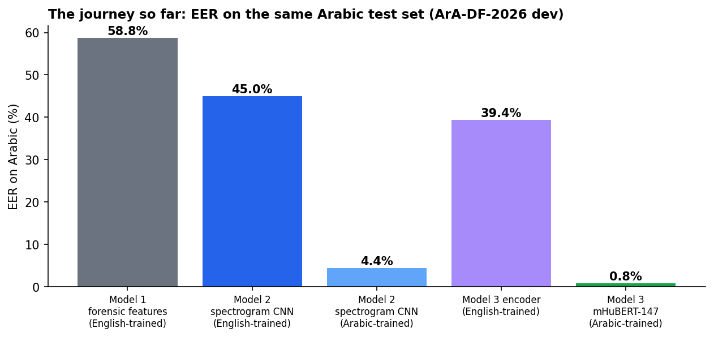
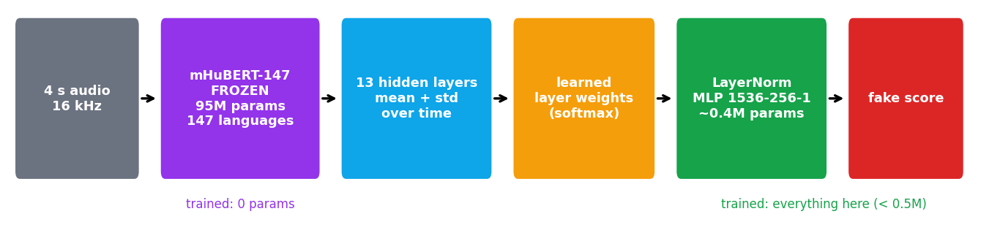
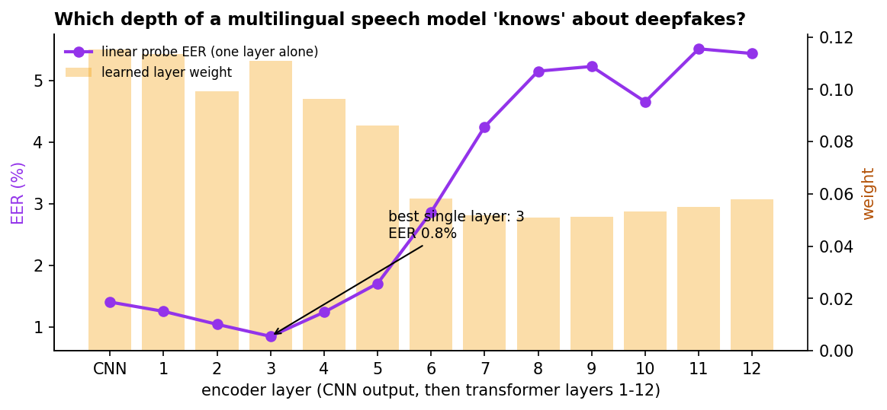
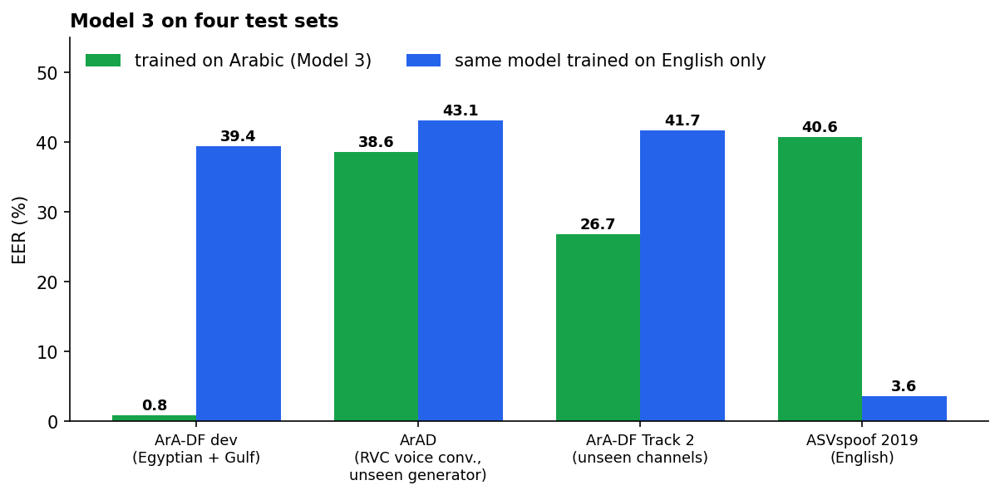
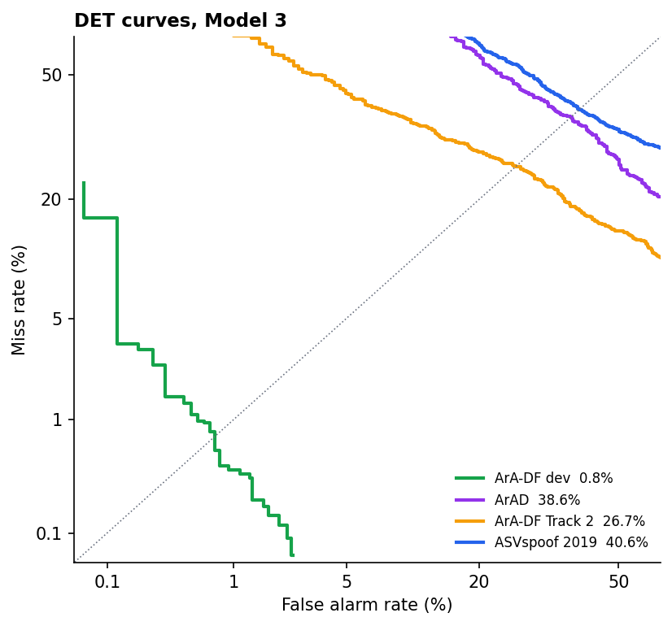
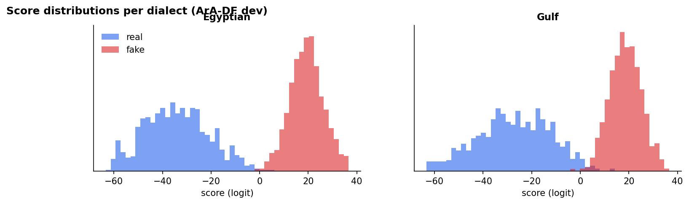
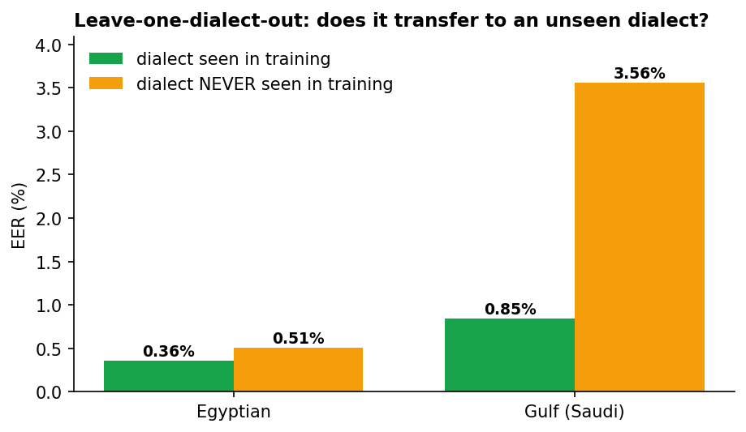

<div align="center">

# QDF-03 · Arabic Deepfake Voice Detector on a Frozen Multilingual Encoder

**mHuBERT-147 (frozen, 147 languages) + a 0.4 M-parameter layer-weighted head, trained on three Arabic dialects. 0.77 % EER on ArA-DF-2026, and 3.6 % on a dialect it never heard.**


-9333ea)


Model 3 of 5 in the **QDF research series** by **Evan Deep** (Qassim DeepFake Challenge 2026, audio track)

[Motivation](#1-motivation) · [Method](#2-method) · [Results](#3-results) · [What it cannot do yet](#4-what-it-cannot-do-yet) · [Reproduce](#5-reproduce)

</div>

---

> ### ملخّص بالعربية
> النموذج الثالث يعالج المشكلة التي كشفها النموذجان الأول والثاني: **الكاشف المدرَّب على الإنجليزية لا يعمل على العربية**. استخدمنا نموذج كلام متعدد اللغات مدرَّبًا مسبقًا على 147 لغة منها العربية (mHuBERT-147) وأبقيناه **مجمّدًا**، ودرّبنا فوقه طبقة صغيرة (0.4 مليون معامل) على بيانات عربية من ثلاث لهجات: مصرية وخليجية وفصحى.
> * نسبة الخطأ على بيانات الاختبار العربية: **0.77%** (كانت 58.8% في النموذج الأول).
> * على **اللهجة الخليجية دون أن يسمعها أثناء التدريب**: 3.6%، أي أن النموذج يعمّم على لهجة جديدة.
> * اكتشفنا أن **الطبقات السفلى** (الأقرب للصوت الخام) هي الأكثر معرفة بالتزييف.
> * **نقطة الضعف:** عند تغيّر قناة الصوت (ضغط، هاتف، إعادة تسجيل) يرتفع الخطأ إلى 26.7%، ومع مولّد غير معروف (RVC) إلى 38.6%. **النموذج الرابع يعالج القنوات.**

---

## TL;DR

| Test set | What it probes | EER | AUC |
|---|---|---:|---:|
| **ArA-DF-2026 dev** (Egyptian + Gulf, 5 000 files) | in-domain Arabic | **0.77 %** | 0.9996 |
| ↳ Egyptian / Gulf | per dialect | 0.36 % / 0.85 % | |
| **Gulf, held out of training** | an Arabic dialect the model never heard | **3.56 %** | |
| ArA-DF Track 2 dev (2 500 files) | *unseen recording channels* | 26.7 % | 0.82 |
| ArAD (RVC v2, Levantine, 1 988 files) | *unseen generator* | 38.6 % | 0.66 |
| ASVspoof 2019 LA (English) | other language and generators | 40.6 % | 0.62 |

<p align="center"></p>

---

## 1. Motivation

Models 1 and 2 hit the same wall: **a detector trained on English fails on Arabic.** Model 1's forensic features *invert* (58.8 % EER) because the clues it learned point the opposite way in Arabic data. We need two things:

1. **Training data in Arabic.** We use the official train split of [ArA-DF-2026](https://huggingface.co/datasets/ArabicSpeech/ArA-DF-2026): 2 500 files each of Egyptian, Gulf and MSA.
2. **A front-end that already understands Arabic speech**, so the small amount of labelled data is spent on *fakes*, not on learning what Arabic sounds like.

For (2) we use **mHuBERT-147** (Boito et al., Interspeech 2024): a 95 M-parameter HuBERT model trained without labels on 90 k hours of speech in 147 languages, Arabic included. At 378 MB it is under a third of the size of XLS-R-300M (1.27 GB) and runs on a laptop GPU (Apple M3, ~20 files/s).

## 2. Method

<p align="center"></p>

| Step | Detail |
|---|---|
| Input | 16 kHz mono, **silence trimmed** (lesson from Model 1), peak-normalised, 4 s centre crop (shorter files are tiled) |
| Encoder | `utter-project/mHuBERT-147`, **frozen**. All 13 hidden states (CNN + 12 transformer layers), 50 frames/s |
| Pooling | mean and standard deviation over time per layer → 13 × 1 536 |
| Head | per-dimension standardisation → **softmax-weighted sum of layers** (SUPERB-style) → LayerNorm → MLP 1536-256-1 with dropout 0.3 |
| Training | BCE with class weighting, AdamW (lr 1e-3, wd 1e-2), 40 epochs, Gaussian feature noise (σ = 0.05 in standardised space), best epoch chosen on a 10 % validation split |
| Cost | encoder pass ≈ 7 min for 7 500 files; head training < 1 min on CPU |

Freezing the encoder keeps its multilingual knowledge intact and makes the trainable part tiny (0.4 M parameters), which matters with only 7 500 labelled files.

### A one-line fix worth 4×: standardise the inputs
Our first head fed raw encoder statistics into the weighted sum. The upper layers have larger activations, so they dominated whatever the layer weights said. Standardising each dimension with training-set statistics fixed that:

| | ArA-DF dev | Track 2 | ArAD |
|---|---:|---:|---:|
| without standardisation | 3.02 % | 32.5 % | 50.8 % |
| **with standardisation** | **0.77 %** | **26.7 %** | **38.6 %** |

(`results/ablation_standardisation.json`; same data, seed and head.)

## 3. Results

### 3.1 Which layer knows about deepfakes?
<p align="center"></p>

A logistic-regression probe on **one layer at a time** reaches **0.8 % EER at layer 3** and gets steadily worse towards the top (5.5 % at layer 11). The learned layer weights agree and put most of their mass on layers 0–5.

**Interpretation:** the evidence for synthetic speech lives in the **lower, acoustic layers** (fine spectral and temporal detail), not in the upper, linguistic layers. That is good news for language transfer, because acoustics are less language-specific than phonetics. It is bad news for **channel robustness**: acoustic detail is exactly what codecs, phone lines and loudspeakers destroy (§4).

### 3.2 Four test sets
<p align="center"></p>
<p align="center"> </p>

* **In-domain Arabic: 0.77 % EER.** The score distributions per dialect barely overlap.
* **Training language matters in both directions.** The *same* encoder and head trained on English ASVspoof reach 3.6 % on English but 39.4 % on Arabic. Trained on Arabic, they reach 0.77 % on Arabic but 40.6 % on English. A frozen multilingual encoder does **not** by itself make a detector language-independent. The training data does.

### 3.3 Unseen dialect: is Gulf Arabic a problem?
<p align="center"></p>

Leave-one-dialect-out: train on two dialects, test on the third (ArA-DF dev).

| Held-out dialect | Seen in training | **Never seen** |
|---|---:|---:|
| Egyptian | 0.36 % | 0.51 % |
| **Gulf (Saudi)** | 0.85 % | **3.56 %** |

The detector transfers to an unseen dialect, but **Gulf is the hardest**: its error grows about 4× when it is held out. For a detector deployed in Qassim, this is the most relevant number in this repository, and it shows that **Gulf training data must be in the training set**.

## 4. What it cannot do yet

| Weakness | Evidence | Next step |
|---|---|---|
| **Channel shift** | Track 2 dev (unseen acoustic and channel conditions): 0.77 % → **26.7 %** | **Model 4**, channel-robust training (WhatsApp Opus, G.711 phone, MP3/AAC, replay, noise) |
| **Unseen generator** | ArAD (RVC v2 voice conversion, Levantine, ≤ 3 s clips): **38.6 %** | more generator diversity; Model 4 also reports ArAD |
| **Short and partial fakes** | file-level pooling averages a 1-second fake word away | **Model 5**, frame-level localisation |

Data caveats: we use 2 500 randomly sampled files per train shard (7 499 total) and 2 500 per dev shard (Egyptian and Gulf; MSA dev was not downloaded). ArAD clips (≤ 3 s) are tiled to 4 s.

## 5. Reproduce

```bash
pip install -r requirements.txt
# audio caches are shared by Models 2-5 (../data/cache), built from ../data/raw
python scripts/01_build_cache.py --corpus aradf_train      # 2 500 per shard: EGY, Gulf, MSA
python scripts/01_build_cache.py --corpus aradf_dev
python scripts/01_build_cache.py --corpus aradf_track2
python scripts/01_build_cache.py --corpus arad --max-items 2000
python scripts/01_build_cache.py --corpus asvspoof
python scripts/02_extract_ssl.py      # frozen mHuBERT-147, ~20 files/s on Apple M3 (MPS)
python scripts/03_train.py            # E1-E4, a few minutes on CPU
python scripts/04_make_figures.py
```

```
qdf-03-arabic-ssl-detector/
├── src/arabic_ssl/
│   ├── backbone.py   # frozen mHuBERT-147 wrapper, per-layer mean/std pooling
│   ├── head.py       # standardisation + softmax layer weights + MLP
│   ├── data.py       # ArA-DF / ArAD / ASVspoof readers (shared schema)
│   └── metrics.py
├── scripts/          # 01 cache → 02 encoder features → 03 train/eval → 04 figures
├── results/          # metrics.json, ablation_standardisation.json, models/head_main.pt
└── assets/figures/
```

## References

1. M. Z. Boito, V. Iyer, N. Lagos, L. Besacier, I. Calapodescu, *mHuBERT-147: A Compact Multilingual HuBERT Model*, Interspeech 2024.
2. W.-N. Hsu et al., *HuBERT: Self-Supervised Speech Representation Learning by Masked Prediction of Hidden Units*, IEEE/ACM TASLP 2021.
3. S. Yang et al., *SUPERB: Speech processing Universal PERformance Benchmark*, Interspeech 2021 (layer-weighted sum).
4. H. Tak et al., *Automatic Speaker Verification Spoofing and Deepfake Detection Using wav2vec 2.0 and Data Augmentation*, Odyssey 2022 (SSL front-ends for anti-spoofing).
5. ArabicSpeech, *ArA-DF-2026* dataset; *ArAD: Arabic Audio DeepFake Dataset* (DeepFake-Audio-Rangers, Hugging Face).
6. X. Wang et al., *ASVspoof 2019*, Computer Speech & Language, 2020.

## Citation
```bibtex
@misc{qdf03_2026,
  title  = {QDF-03: Arabic Deepfake Voice Detection on a Frozen Multilingual Encoder},
  author = {Evan Deep},
  year   = {2026},
  note   = {Model 3 of the QDF research series, Qassim DeepFake Challenge}
}
```
Code: MIT. Model weights of mHuBERT-147 and all datasets keep their own licences.
